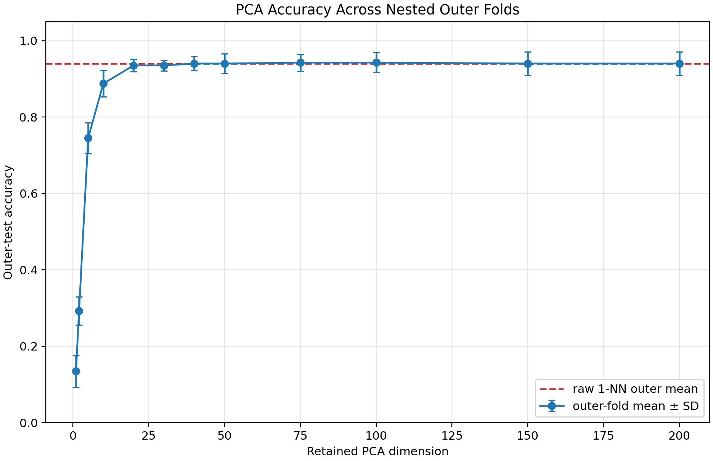
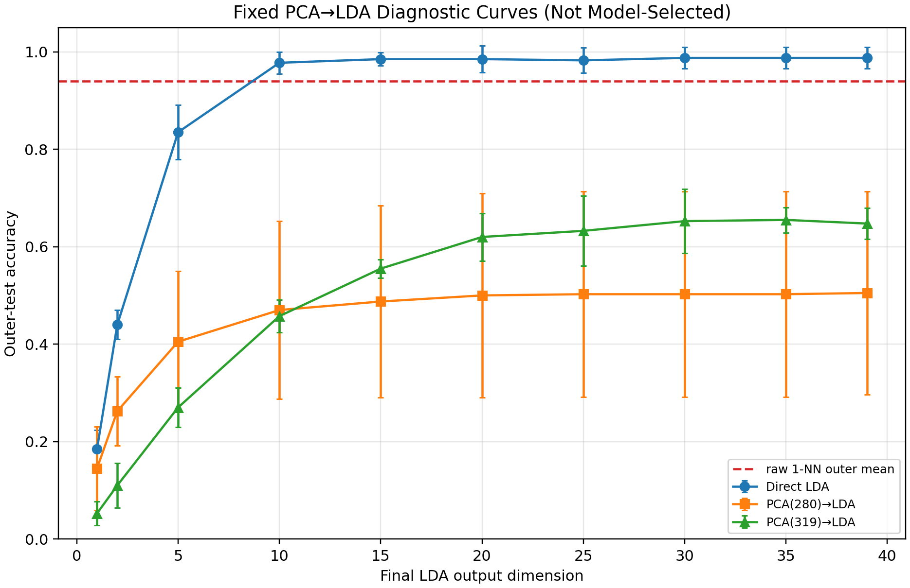
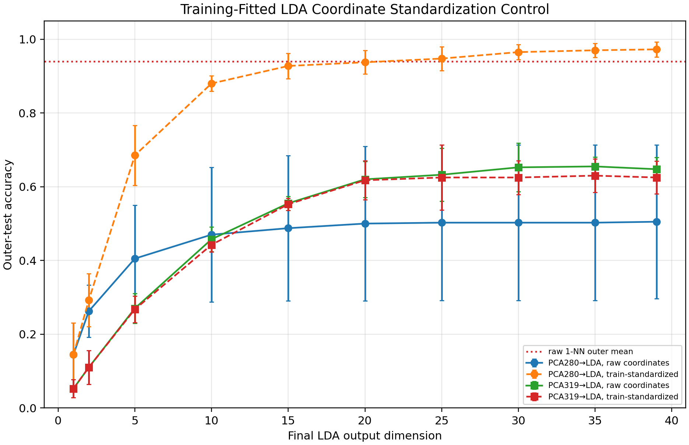

# Dimensionality Reduction for Face Classification Using PCA and LDA

**JI YANCHEN**

EE6222 - Assignment 1

## Abstract

This study evaluates how representation dimension affects Euclidean 1-nearest-neighbour (1-NN) classification on Olivetti Faces. A nested 5-fold outer / 4-fold inner design selects dimensions using outer-training data and scores each selected model once on its outer fold. Across 400 out-of-fold predictions, the mean fold accuracy is 0.9400 for raw pixels, 0.9350 for inner-selected PCA, 0.9875 for direct LDA, and 0.9850 for inner-selected PCA-to-LDA. The earlier PCA280-to-LDA collapse is metric-sensitive: training-fitted standardization of LDA coordinates raises its outer-fold accuracy from 0.5000 to 0.9375 at 20 outputs. PCA319-to-LDA remains lower; its within-class SVD rank is 280 of 319, and the solver truncates 39 directions containing about 90% of standardized class-center energy. These results are specific to this dataset and classifier.

## 1. Introduction

A 64 × 64 face image becomes a 4096-dimensional pixel vector. PCA preserves directions of high total variance, whereas LDA uses identity labels to construct class-discriminative coordinates [1, 2]. Their interaction matters to a distance-based classifier: 1-NN is sensitive to both the retained subspace and coordinate scaling.

This assignment compares raw pixels, PCA, direct LDA, and PCA followed by LDA with one fixed classifier. The analysis focuses on dimension curves and investigates why high-dimensional PCA-to-LDA settings performed poorly under the original Euclidean metric. Mechanisms are treated as interpretations of this experiment, not universal claims.

## 2. Experimental Methods

### Dataset and preprocessing

The scikit-learn Olivetti loader supplies 400 grayscale images from 40 identities, 10 images per identity, each flattened to 4096 values in [0, 1] [3]. The original Database of Faces page requests credit to AT&T Laboratories Cambridge [6]. The public program downloads the data through scikit-learn when the cache is absent. All fitting uses training samples; PCA centers its training input. The classifier is Euclidean 1-NN (k = 1). LDA uses scikit-learn 1.7.2 with `solver="svd"` and `tol=1e-4` [4].

### Nested selection and evaluation

The fixed outer partition is a shuffled stratified 5-fold split (`random_state=20261012`). Each outer fold has 320 training and 80 test images, with 8 and 2 images per identity; the five test folds partition the 400 images exactly once. Within each outer training fold, shuffled stratified 4-fold CV (`random_state=20261020 + fold`) selects dimensions by mean validation accuracy. Ties prefer the smaller output dimension, then the smaller PCA pre-dimension. The selected pipeline is refitted on the full outer training fold and evaluated on its outer test fold. This follows the train-only model-selection / held-out scoring separation described in standard cross-validation practice [5].

PCA candidates are 1, 2, 5, 10, 20, 30, 40, 50, 75, 100, 150, and 200. Direct LDA and PCA-to-LDA final dimensions are 1, 2, 5, 10, 15, 20, 25, 30, 35, and 39. PCA-to-LDA pre-dimensions 50, 75, 100, 150, and 200 are eligible for inner selection. PCA280 and PCA319 are fixed diagnostic controls, not selected from outer-test scores.

### Curves, controls, and scope

Every fixed dimension is fitted on an outer training fold and scored on its outer test fold to create performance curves. Error rate is 1 - accuracy. The LDA-coordinate normalization control fits a `StandardScaler` on training outputs only, then applies it to train and test outputs before 1-NN. It is a post-hoc diagnostic prompted by the observed scale imbalance, not part of dimension selection or the selected-model comparison. Tables and curves report the mean and sample SD across five outer folds. These folds reuse one dataset and their SD is descriptive, not a confidence interval or variation across independent datasets.

The previous v1 experiment used the seed-42 test curve to choose representative dimensions, then repartitioned the same 400 images for seeds 100-119. Those v1 repeated-holdout numbers are retained as historical evidence, not treated as independent confirmation. This v2 analysis uses nested selection per outer fold, but follows that earlier exploration and has no external sample-level test set.

## 3. Results

| Method | Inner-selected settings across folds | Outer mean accuracy ± SD |
|---|---|---:|
| Raw 1-NN | 4096 pixels | 0.9400 ± 0.0311 |
| PCA + 1-NN | 40 (2 folds), 75, 150, 200 | 0.9350 ± 0.0298 |
| Direct LDA + 1-NN | 25, 30 (2), 35, 39 outputs | 0.9875 ± 0.0217 |
| PCA-to-LDA + 1-NN | PCA 50/75/100; LDA 30/35/39 | 0.9850 ± 0.0224 |

**Table 1.** Each selected-model mean aggregates five outer folds (80 test predictions per fold; 400 out-of-fold predictions total). Direct LDA classified 395/400 images correctly and selected PCA-to-LDA classified 394/400. The one-prediction difference is descriptive; five folds do not support a precise ranking between these two settings.

PCA accuracy rises quickly at low dimension: 0.7450 at 5 components, 0.8875 at 10, and 0.9350 at 20. It then plateaus between 0.9350 and 0.9425 from 20 to 200 components; the peak is 0.9425 at 75 and 100. Thus, most of the observed gain occurs by 20 components, and adding components does not produce a monotonic improvement.

## 3. Results (continued)

Direct LDA rises from 0.1850 at one output to 0.9775 at 10, then stays between 0.9825 and 0.9875 from 15 to 39. Its use of labels is consistent with stronger identity separation than variance-only PCA on this dataset. The inner-selected PCA-to-LDA models also score highly, averaging 0.9850; the earlier poor results therefore apply to the tested high pre-dimensions and raw Euclidean geometry, not to every PCA-to-LDA configuration.

At PCA280-to-LDA20, raw Euclidean 1-NN averages 0.5000 ± 0.2095 across outer folds. Standardizing each LDA coordinate from outer-training outputs raises this to 0.9375 ± 0.0319; at 39 outputs it reaches 0.9725 ± 0.0205. PCA319-to-LDA25 averages 0.6325 ± 0.0716, and the same coordinate standardization yields 0.6250 ± 0.0884. The metric control strongly supports a coordinate-scale effect for PCA280 and does not explain the PCA319 result.

## 4. Discussion

### Why the high-dimensional PCA-to-LDA controls differ

For 320 training samples and 40 classes, the within-class scatter rank is at most 320 - 40 = 280. Scikit-learn’s SVD solver scales within-class-centered features by their within-class standard deviation, keeps within singular values strictly above the absolute threshold 1e-4, then performs a second SVD on class centers with a relative threshold [4]. PCA280 is full within-rank: the seed-42 fit retains 280/280 directions, with retained-spectrum condition number 265.3. Across the five outer folds, the condition ranges from 503 to 3472. LDA output coordinate scales are unequal (median max/min SD ratio 15.2). In the 40-case, one-per-identity internal check, the median nearest-same / nearest-different distance ratio changes from 0.619 to 0.485 after standardization; PCA319 remains near 1.000 before and after. Training-fitted coordinate standardization restores PCA280-to-LDA accuracy, so ordinary Euclidean distance on raw outputs is a substantial part of its collapse. It does not establish that scaling is the only relevant mechanism. Because the scale control followed inspection of the fixed curves, its accuracy is exploratory rather than confirmatory.

PCA319 has 319 input features but still at most 280 within-class directions. The SVD solver retains 280 and truncates 39. In the seed-42 training fit, 90.1% of the standardized class-center squared energy lies in those discarded directions; the five outer fits range from 89.9% to 90.5%. This provides a data-specific mechanism for losing useful between-class structure. Its retained within spectrum is well-conditioned (condition 1.62), LDA output scales are nearly balanced (median ratio 1.24), and coordinate standardization does not recover accuracy. The result is therefore consistent with rank-truncation loss, rather than a simple output-scale imbalance. The 319-dimensional leave-one-out diagnostic is additionally a boundary stress case: each inner fit has 319 rows, so centered PCA has rank at most 318 and its last component is near zero. That near-chance LOO score is not used as a test estimate and does not explain the less severe 0.63 outer-fold result by itself.

### Evaluation limits and conclusion

The original v1 representative settings were selected from seed-42 test accuracy, which is performance-guided dimension selection. New seeds 100-119 changed the split, not the image sample; they are repeated holdouts, not an independent test set. In v2, each outer test fold is used only for the fixed performance curves and the selected-model score, while its dimensions are chosen inside the outer training data. The earlier seed-42 exploration informed this follow-up, and the scale and nullspace analyses were also post-hoc diagnostics on the same image cohort. The results are a transparent cross-validation study, not an independent replication or causal confirmation.

On this dataset and classifier, direct LDA and inner-selected PCA-to-LDA both approach 99% accuracy, while selected PCA stays near raw 1-NN. The earlier high-dimensional PCA-to-LDA collapse is explained in part by unequal LDA-coordinate scales at PCA280 and by SVD truncation of within-null directions at PCA319. It is not evidence that PCA-to-LDA is generally inferior.

## References

[1] X. Jiang, “Linear Subspace Learning-Based Dimensionality Reduction,” *IEEE Signal Processing Magazine*, vol. 28, no. 2, pp. 16-26, 2011. doi: 10.1109/MSP.2010.939041.

[2] P. N. Belhumeur, J. P. Hespanha, and D. J. Kriegman, “Eigenfaces vs. Fisherfaces: Recognition Using Class Specific Linear Projection,” *IEEE Transactions on Pattern Analysis and Machine Intelligence*, vol. 19, no. 7, pp. 711-720, 1997. doi: 10.1109/34.598228.

[3] Scikit-learn developers, `fetch_olivetti_faces` API reference, version 1.7.2, accessed 12 Oct. 2026: scikit-learn.org/1.7/modules/generated/sklearn.datasets.fetch_olivetti_faces.html.

[4] Scikit-learn developers, `LinearDiscriminantAnalysis` API reference, version 1.7.2, accessed 12 Oct. 2026: scikit-learn.org/1.7/modules/generated/sklearn.discriminant_analysis.LinearDiscriminantAnalysis.html.

[5] Scikit-learn developers, “Cross-validation: evaluating estimator performance,” version 1.7.2, accessed 12 Oct. 2026: scikit-learn.org/1.7/modules/cross_validation.html.

[6] AT&T Laboratories Cambridge, “The Database of Faces,” accessed 13 Oct. 2026: https://www.cl.cam.ac.uk/research/dtg/attarchive/facedatabase.html.

<!-- APPENDIX -->
